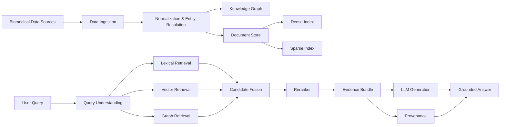
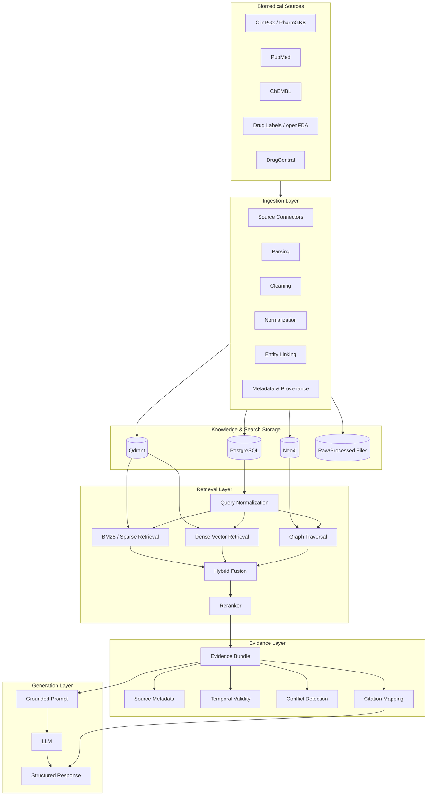
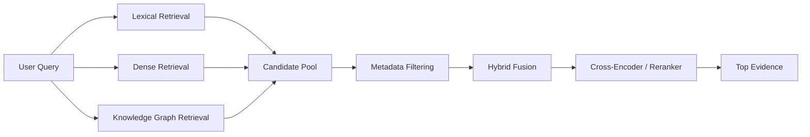
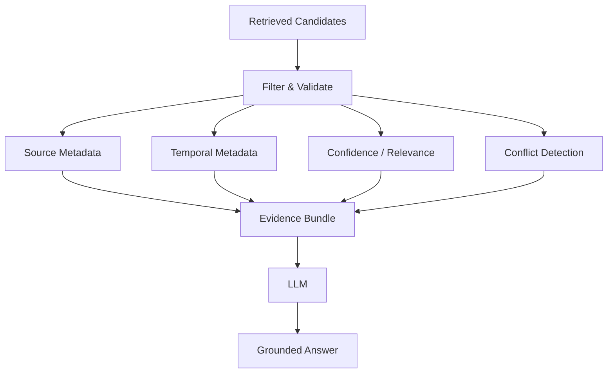
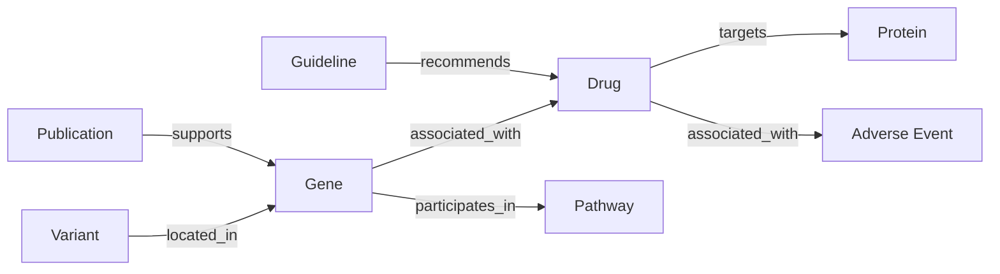
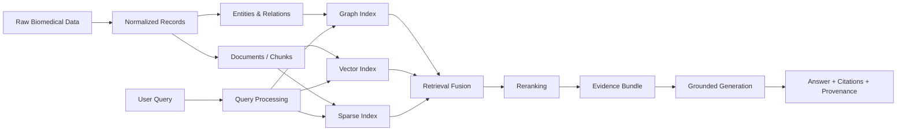
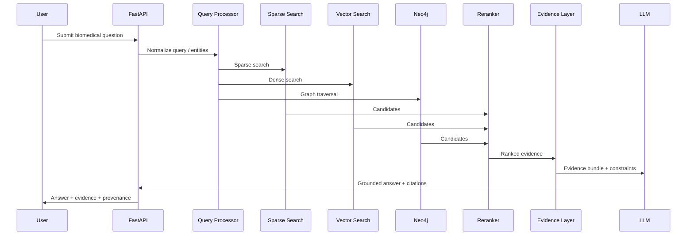
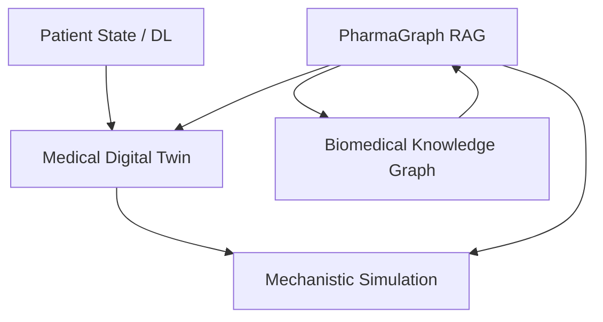

# PharmaGraph RAG

## Evidence-Grounded Pharmacogenomics & Drug Intelligence System

> **Project type:** Research/engineering portfolio project
>
> **Primary focus:** Biomedical RAG + Knowledge Graph + Hybrid Retrieval + Reranking + Evidence Provenance
>
> **Purpose:** Build a strong standalone RAG system that can later become the evidence layer of a larger medical digital twin.

---

## 1. Project Overview

### 1.1 What is PharmaGraph?

**PharmaGraph** is an evidence-grounded biomedical Retrieval-Augmented Generation (RAG) system focused on **drugs, genes, variants, diseases, biological targets, adverse effects, and pharmacogenomics**.

The system combines:

- Biomedical document retrieval
- Lexical/keyword retrieval
- Dense semantic retrieval
- Knowledge-graph traversal
- Candidate fusion and reranking
- Evidence bundling
- Source and temporal provenance
- LLM-based answer generation

The system is designed so that the generated answer is **downstream of retrieved evidence**, rather than treating the LLM itself as the source of truth.

### 1.2 Core Problem

A normal RAG chatbot can retrieve semantically similar text, but biomedical questions often contain:

- Exact identifiers such as gene symbols, variants, PMIDs, drug names, or molecular identifiers
- Multi-hop relationships such as `variant -> gene -> drug -> response`
- Conflicting findings across papers or sources
- Evidence that changes over time
- Different levels of authority across sources

PharmaGraph is intended to address these problems through a **hybrid retrieval architecture**.

### 1.3 Example Questions

The final system should be able to handle questions such as:

- What is the relationship between CYP2C19 variants and clopidogrel response?
- Which genes are associated with the response to a given drug?
- What evidence links a drug to a particular adverse event?
- Which biological targets are associated with a drug?
- What publications support a specific drug-gene relationship?
- Are there conflicting findings about a drug-gene association?
- What is the most recent evidence available for a biomedical relationship?

### 1.4 Final Goal

The final goal is to build a **research-grade biomedical RAG pipeline** that can return:

1. A concise evidence-grounded answer.
2. Ranked supporting evidence.
3. Source identifiers and dates.
4. Relevant knowledge-graph relationships.
5. A clear distinction between retrieved evidence and generated explanation.
6. Conflict/freshness information where applicable.
7. Reproducible retrieval and evaluation results.

The project should be suitable as the **RAG/KG supporting system** for the larger Neural-Mechanistic Personalized Medical Digital Twin.

---

## 2. Project Scope

### In Scope

- Biomedical literature retrieval
- Pharmacogenomics knowledge
- Drug and target information
- Drug adverse-event information
- Biomedical entity resolution
- Knowledge graph construction
- Dense retrieval
- Sparse/lexical retrieval
- Hybrid retrieval
- Graph retrieval
- Candidate fusion
- Reranking
- Evidence bundle construction
- Citation/provenance tracking
- Basic conflict detection
- Temporal/freshness metadata
- RAG answer generation
- Retrieval and citation evaluation

### Out of Scope

- Autonomous diagnosis
- Treatment recommendation
- Clinical prescribing
- Clinical decision support
- Patient-specific treatment decisions
- Clinical validation
- Training models on identifiable patient data

---

## 3. High-Level Concept



---

## 4. Core Architecture

### 4.1 System Architecture



---

## 5. Retrieval Architecture

PharmaGraph should use **three retrieval paths** and combine them before final generation.



### Retrieval Roles

| Retrieval Path | Primary Purpose |
|---|---|
| Sparse / BM25 | Exact biomedical terms, identifiers, names, codes |
| Dense vectors | Semantic similarity and paraphrased questions |
| Knowledge graph | Multi-hop biomedical relationships |
| Reranker | Final relevance ordering over a smaller candidate set |

Qdrant supports dense+sparse hybrid retrieval and multi-stage reranking workflows, making it suitable for the vector retrieval layer.  
Neo4j provides graph retrieval and a first-party GraphRAG Python package for connecting graph retrieval to LLM generation.

---

## 6. Evidence Bundle Architecture

The most important design rule is:

> **The LLM should receive an evidence bundle, not an uncontrolled collection of retrieved text.**



A conceptual evidence object:

```json
{
  "source_id": "PMID:12345678",
  "source_type": "publication",
  "title": "...",
  "date": "2025-04-12",
  "chunk_id": "pub_123_chunk_07",
  "entities": ["CYP2C19", "clopidogrel"],
  "retrieval_paths": ["dense", "sparse", "graph"],
  "relevance_score": 0.91,
  "evidence_text": "...",
  "graph_relationships": [
    "CYP2C19 -> associated_with -> clopidogrel_response"
  ],
  "provenance": {
    "source_version": "...",
    "ingested_at": "..."
  }
}
```

---

## 7. Knowledge Graph Design

### 7.1 Main Node Types

```text
Drug
Gene
Variant
Protein
Target
Disease
Phenotype
Pathway
AdverseEvent
Publication
Guideline
DrugLabel
Source
```

### 7.2 Main Relationships

```text
Variant       -> located_in        -> Gene
Gene          -> affects_response  -> Drug
Drug          -> treats            -> Disease
Drug          -> targets           -> Protein
Drug          -> associated_with   -> AdverseEvent
Gene          -> participates_in   -> Pathway
Publication   -> supports          -> Relationship
Guideline     -> recommends        -> Drug
DrugLabel     -> describes         -> Drug
Source        -> supports          -> Evidence
```

### 7.3 Example Graph



---

## 8. Dataset Plan

The project should start with a small, high-quality corpus and grow incrementally.

### 8.1 Recommended Primary Sources

| Source | Main Use | Data Used | Integration Priority |
|---|---|---|---|
| **ClinPGx / PharmGKB** | Pharmacogenomics knowledge | Genes, variants, drugs, clinical annotations, guidelines, relationships | P0 |
| **PubMed / NCBI E-utilities** | Biomedical literature | Publications, abstracts, metadata, PMIDs | P0 |
| **ChEMBL** | Drug/compound biology | Compounds, targets, bioactivity, identifiers | P1 |
| **openFDA Drug Labeling** | Drug labels and safety information | Indications, adverse reactions, interactions, labeling metadata | P1 |
| **DrugCentral** | Drug intelligence enrichment | Drug structures, targets, interactions, identifiers | P1 |

### 8.2 Optional / Later Sources

| Source | Purpose |
|---|---|
| SIDER-like adverse-event resources | Dedicated drug-adverse-event enrichment |
| Pathway databases | Biological pathway relationships |
| UniProt | Protein and gene normalization |
| MeSH / UMLS where licensing/access permits | Biomedical terminology and entity mapping |
| Institution-approved guidelines | Higher-authority clinical evidence |

### 8.3 Suggested MVP Dataset

For the first version, use:

```text
1. ClinPGx / PharmGKB
2. PubMed
3. ChEMBL
4. openFDA Drug Labeling
```

Do not ingest the whole universe of biomedical literature at the beginning. Start with a constrained domain such as:

```text
Pharmacogenomics + cardiovascular drugs
```

or:

```text
Pharmacogenomics + oncology drugs
```

### 8.4 Data Acquisition Notes

- Prefer official APIs, downloadable datasets, or explicitly permitted programmatic interfaces.
- Store the original source identifier for every record.
- Preserve source version/date and ingestion timestamp.
- Preserve licensing/usage metadata.
- Do not treat generated summaries as source data.
- Rebuild derived indexes when source versions change.

NCBI provides E-utilities for programmatic access to PubMed and other Entrez databases. ChEMBL provides programmatic web services for chemical, target, and bioactivity data. openFDA provides programmatic access to public drug-labeling data, with downloadable dataset files as well. DrugCentral provides downloadable database and drug-target data.  

---

## 9. Technology Stack

### 9.1 Core Stack

| Layer | Recommended Technology | Role |
|---|---|---|
| Language | Python 3.12+ | Main development language |
| API | FastAPI | Retrieval and application API |
| Relational DB | PostgreSQL | Metadata, source registry, evaluation data |
| Graph DB | Neo4j | Biomedical knowledge graph |
| Vector DB | Qdrant | Dense + sparse retrieval |
| Embeddings | sentence-transformers / biomedical encoder | Dense embeddings |
| Sparse retrieval | BM25 / sparse vectors | Exact and lexical matching |
| Reranker | Cross-encoder / late-interaction model | Candidate reranking |
| RAG orchestration | LangGraph or LlamaIndex | Pipeline orchestration |
| LLM | Configurable LLM provider/model | Final grounded generation |
| Data validation | Pydantic + custom validators | Schema and contract checks |
| Experiment tracking | MLflow | Retrieval experiments and metrics |
| Data versioning | DVC | Dataset/index versioning |
| Containers | Docker | Reproducible deployment |
| Frontend | React + TypeScript | Research/demo UI |

### 9.2 Supporting Tools

```text
Git / GitHub
pytest
Ruff
mypy (optional)
Docker Compose
Jupyter (experiments only)
Prometheus / Grafana (later)
OpenTelemetry (later)
```

---

## 10. Logical Data Flow



---

## 11. Implementation Guide

This is intentionally a **high-level build sequence**, not a detailed tutorial.

### Phase 1 — Project Foundations

1. Create the repository.
2. Set up Python, FastAPI, Docker Compose and environment configuration.
3. Define project schemas for documents, sources, entities, relations, chunks, evidence and queries.
4. Create PostgreSQL, Neo4j and Qdrant services.
5. Add automated tests and linting from the beginning.

### Phase 2 — Data Gathering

1. Start with a constrained biomedical topic.
2. Gather pharmacogenomics records from **ClinPGx / PharmGKB**.
3. Gather relevant literature metadata/abstracts from **PubMed** through NCBI E-utilities.
4. Gather drug/target/bioactivity enrichment from **ChEMBL**.
5. Add drug labels from **openFDA**.
6. Optionally add DrugCentral after the core pipeline is stable.
7. Save raw source files/records before transformation.

### Phase 3 — Data Normalization

1. Normalize drug names and identifiers.
2. Normalize genes and variants.
3. Normalize publication identifiers such as PMID.
4. Normalize dates and source versions.
5. Create canonical internal entity IDs.
6. Preserve the mapping from canonical ID back to the original source.

### Phase 4 — Build the Knowledge Graph

1. Define the node and relationship schema.
2. Load drugs, genes, variants, diseases, proteins and publications.
3. Add relationships from pharmacogenomics and drug data.
4. Store relationship provenance.
5. Store confidence and validity/freshness metadata where available.
6. Test graph traversal queries independently of the RAG system.

### Phase 5 — Build the Document Corpus

1. Select the document fields that are useful for retrieval.
2. Split long documents into meaningful biomedical chunks.
3. Preserve document ID, chunk ID, source, date and section metadata.
4. Avoid losing the original document-to-chunk relationship.

### Phase 6 — Build Retrieval

Implement the retrieval paths separately first:

1. Build BM25/sparse retrieval.
2. Build dense vector retrieval.
3. Build graph retrieval.
4. Add metadata filtering.
5. Compare each retrieval method independently.

### Phase 7 — Build Hybrid Retrieval

1. Run sparse retrieval.
2. Run dense retrieval.
3. Run graph retrieval.
4. Merge candidate sets.
5. Apply a fusion method such as Reciprocal Rank Fusion.
6. Add a reranker on the smaller candidate set.
7. Return the top evidence candidates.

### Phase 8 — Build the Evidence Layer

1. Create the evidence-bundle schema.
2. Attach source and temporal metadata.
3. Store retrieval scores and retrieval paths.
4. Map claims/evidence back to source IDs.
5. Add basic evidence conflict detection.
6. Reject or flag unsupported evidence.

### Phase 9 — Build the RAG Generation Layer

1. Create a grounded prompt template.
2. Pass the evidence bundle to the LLM.
3. Force a structured response format.
4. Require citations/source IDs in the generated response.
5. Separate retrieved evidence from generated explanation.
6. Add a fallback response when evidence is insufficient.

### Phase 10 — Build Evaluation

Create a fixed benchmark of biomedical questions with expected relevant sources.

Measure at minimum:

- Recall@k
- Precision@k
- MRR
- nDCG
- Citation correctness
- Retrieval latency
- Answer grounding / unsupported-claim rate

Compare:

```text
BM25
Vector only
Graph only
Hybrid
Hybrid + Reranker
```

### Phase 11 — Build the Demo UI

Create a simple research interface with:

```text
Question
   ↓
Answer
   ↓
Citations
   ↓
Retrieved evidence
   ↓
Knowledge graph relationships
   ↓
Source/date metadata
   ↓
Conflicts / freshness
```

### Phase 12 — Package the Project

1. Add Docker Compose.
2. Add database initialization scripts.
3. Add ingestion commands.
4. Add index-building commands.
5. Add evaluation commands.
6. Add API documentation.
7. Add architecture and experiment documentation.
8. Record dataset/model/source versions for reproducibility.

---

## 12. Suggested Repository Structure

```text
pharmagraph/
│
├── app/
│   ├── api/
│   ├── config/
│   ├── ingestion/
│   ├── normalization/
│   ├── entities/
│   ├── graph/
│   ├── retrieval/
│   │   ├── sparse/
│   │   ├── dense/
│   │   ├── graph/
│   │   ├── fusion/
│   │   └── reranking/
│   ├── evidence/
│   ├── generation/
│   └── evaluation/
│
├── data/
│   ├── raw/
│   ├── processed/
│   └── manifests/
│
├── graph/
│   ├── schema/
│   └── seed/
│
├── experiments/
├── notebooks/
├── tests/
├── scripts/
├── docker/
├── frontend/
├── configs/
├── docs/
│
├── docker-compose.yml
├── pyproject.toml
├── README.md
└── PharmaRAG.md
```

---

## 13. Query Execution Flow



---

## 14. Evaluation Strategy

### 14.1 Retrieval Evaluation

Create a benchmark table like:

| Query | Relevant Source IDs | Expected Entities | Top-k Retrieved | Correct? |
|---|---|---|---|---|
| CYP2C19 + clopidogrel | ... | CYP2C19, clopidogrel | ... | ... |
| Drug + target question | ... | Drug, target | ... | ... |
| Drug + adverse event | ... | Drug, AE | ... | ... |

### 14.2 Required Comparison

```text
Baseline 1: BM25
Baseline 2: Dense retrieval
Baseline 3: Graph retrieval
Experiment 1: Dense + Sparse
Experiment 2: Dense + Sparse + Graph
Experiment 3: Hybrid + Reranker
```

### 14.3 Generation Evaluation

Check:

- Citation correctness
- Unsupported claims
- Missing relevant evidence
- Evidence-to-answer consistency
- Conflict handling
- Freshness handling

### 14.4 Adversarial Evaluation

Include tests for:

- Incorrect entity names
- Ambiguous drug names
- Exact variant IDs
- Conflicting publications
- Stale evidence
- Empty retrieval results
- Prompt injection inside retrieved documents
- Queries outside the supported domain

---

## 15. Final Output of PharmaGraph

A successful final query should produce something conceptually like:

```text
Question
──────────────────────────────────────────────
What evidence links CYP2C19 variants to clopidogrel response?

Answer
──────────────────────────────────────────────
Evidence-grounded summary...

Evidence
──────────────────────────────────────────────
[1] ClinPGx / PharmGKB — source/date
[2] PubMed — source/date
[3] PubMed — source/date

Knowledge Graph
──────────────────────────────────────────────
CYP2C19
   ↓
variant
   ↓
clopidogrel
   ↓
response phenotype

Retrieval Paths
──────────────────────────────────────────────
Sparse:  ✓
Dense:   ✓
Graph:   ✓
Reranked:✓

Conflicts / Freshness
──────────────────────────────────────────────
...

Provenance
──────────────────────────────────────────────
Source versions / ingestion date / query ID / model version
```

---

## 16. MVP Definition

The first complete version does **not** need every possible biomedical source.

### MVP should contain:

- [ ] One constrained biomedical domain
- [ ] ClinPGx / PharmGKB ingestion
- [ ] PubMed ingestion
- [ ] ChEMBL enrichment
- [ ] openFDA labeling enrichment
- [ ] Biomedical entity normalization
- [ ] Neo4j knowledge graph
- [ ] Qdrant vector/sparse index
- [ ] BM25/sparse retrieval
- [ ] Dense retrieval
- [ ] Graph retrieval
- [ ] Hybrid candidate fusion
- [ ] Reranking
- [ ] Evidence bundle
- [ ] Grounded LLM response
- [ ] Source citations
- [ ] Retrieval benchmark
- [ ] Basic UI/API
- [ ] Dockerized deployment

---

## 17. Success Criteria

The project should be considered complete when it can demonstrate that:

1. A biomedical query can be resolved into relevant entities.
2. Sparse, dense and graph retrieval can run independently.
3. Hybrid retrieval can combine the retrieval paths.
4. A reranker can improve the candidate ordering.
5. Every returned evidence item has source metadata.
6. The generated answer can point back to retrieved evidence.
7. Conflicting evidence can be represented rather than silently merged.
8. Retrieval performance is measured quantitatively.
9. The complete pipeline can be reproduced from versioned configuration/data.
10. The project can act as an evidence layer for the later Medical Digital Twin.

---

## 18. Relationship to the Medical Digital Twin

PharmaGraph is intentionally designed as a **supporting project**, not as the final medical platform.



The later Digital Twin can use PharmaGraph to provide:

- Drug evidence
- Gene-drug relationships
- Drug-target relationships
- Adverse-event evidence
- Guideline evidence
- Biomedical literature context
- Evidence provenance for model explanations

---

## 19. Recommended Build Order at a Glance

```text
1. Define domain
      ↓
2. Gather official/approved datasets
      ↓
3. Preserve raw data + provenance
      ↓
4. Normalize entities
      ↓
5. Build Neo4j knowledge graph
      ↓
6. Build document/chunk corpus
      ↓
7. Build sparse retrieval
      ↓
8. Build dense retrieval
      ↓
9. Build graph retrieval
      ↓
10. Fuse retrieval results
      ↓
11. Add reranking
      ↓
12. Build evidence bundles
      ↓
13. Add grounded generation
      ↓
14. Add citation/provenance UI
      ↓
15. Evaluate retrieval + grounding
      ↓
16. Containerize and document
      ↓
17. Integrate later with the Medical Digital Twin
```

---

## 20. Official References

### Biomedical Data

- ClinPGx / PharmGKB: https://www.clinpgx.org/
- NCBI / PubMed APIs (E-utilities): https://www.ncbi.nlm.nih.gov/home/develop/api/
- NCBI E-utilities documentation: https://www.ncbi.nlm.nih.gov/books/NBK25499/
- ChEMBL: https://www.ebi.ac.uk/chembl/
- ChEMBL API documentation: https://www.ebi.ac.uk/chembl/api/data/docs
- openFDA Drug Labeling API: https://open.fda.gov/apis/drug/label/how-to-use-the-endpoint/
- DrugCentral: https://drugcentral.org/

### Retrieval / RAG Infrastructure

- Qdrant hybrid search: https://qdrant.tech/documentation/search/text-search/hybrid-search/
- Qdrant hybrid + reranking: https://qdrant.tech/documentation/tutorials-basics/reranking-hybrid-search/
- Neo4j GraphRAG for Python: https://neo4j.com/docs/neo4j-graphrag-python/current/

---

## 21. Important Data and Usage Notes

- Verify the current license/terms for every dataset before redistribution or public deployment.
- Track source version and ingestion date.
- Keep source identifiers intact.
- Do not copy restricted full-text biomedical content into a public repository without permission.
- Prefer abstracts, metadata, structured annotations, open-access content, or licensed content where appropriate.
- Treat the system as a research/engineering prototype, not a clinical decision system.
- Keep generated answers distinguishable from source evidence.

---

## 22. Final Vision

**PharmaGraph should demonstrate that you can build a real biomedical RAG system, not merely connect an LLM to a vector database.**

The strongest version of the project demonstrates competence in:

```text
Biomedical data engineering
        +
Entity normalization
        +
Knowledge graphs
        +
Lexical retrieval
        +
Dense retrieval
        +
Hybrid retrieval
        +
Reranking
        +
Evidence engineering
        +
LLM grounding
        +
Evaluation
        +
Reproducibility
```

That makes PharmaGraph a direct preparation project for the RAG/KG layer of the larger Medical Digital Twin.
