# PharmaGraph: Evidence-Grounded Pharmacogenomics Intelligence

PharmaGraph is an open-source, evidence-grounded pharmacogenomics (PGx) intelligence engine and clinical research dashboard. It connects curated clinical guidelines ([CPIC](https://cpicpgx.org)), structured variant-drug annotations ([PharmGKB / ClinPGx](https://www.pharmgkb.org)), regulatory drug label annotations (FDA, EMA), real-world Indian brand names ([NRCeS CDCI](https://www.nrces.in)), and peer-reviewed literature ([PubMed](https://pubmed.ncbi.nlm.nih.gov)) without LLM hallucinations, inferred links, or unverified claims.

---

## Table of Contents
1. [Visual Tour & Interface Highlights](#visual-tour--interface-highlights)
2. [Key Capabilities: What PharmaGraph Can Do](#key-capabilities-what-pharmagraph-can-do)
3. [Safety Guardrails: What PharmaGraph Does NOT Do](#safety-guardrails-what-pharmagraph-does-not-do)
4. [System Architecture & Data Flow](#system-architecture--data-flow)
   - [High-Level System Architecture](#1-high-level-system-architecture)
   - [Hybrid Retrieval Pipeline Flow](#2-hybrid-retrieval-pipeline-flow)
   - [Query Mode & Intent Routing Logic](#3-query-mode--intent-routing-logic)
   - [Extractive Claim Synthesis & Citation Verifier](#4-extractive-claim-synthesis--citation-verifier)
5. [Answer Modes](#answer-modes)
6. [Project File Structure](#project-file-structure)
7. [Installation & Setup](#installation--setup)
8. [Running Backend & Frontend](#running-backend--frontend)
9. [Running Tests & Quality Checks](#running-tests--quality-checks)
10. [Data Sources & Legal Provenance](#data-sources--legal-provenance)

---

## Visual Tour & Interface Highlights

### 1. Landing Page & Architectural Transparency
*A quiet, high-density interface detailing verified data sources, corpus counts, search honesty metrics, and supported query templates.*

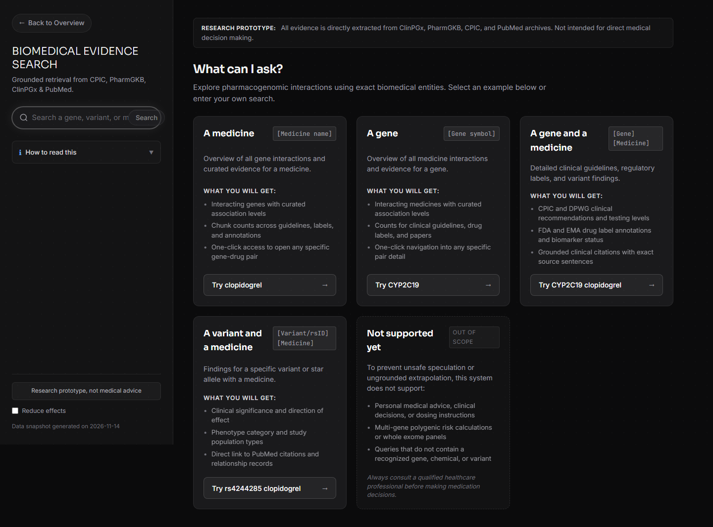

---

### 2. Gene-Medicine Pair Detail Mode
*Structured evidence for gene-drug pairs (e.g., `CYP2C19 + clopidogrel`), with distinct sections for Clinical Guidelines, Drug Label Annotations, Variant Findings, and Linked PubMed Literature. Every claim cites exact chunk source IDs.*

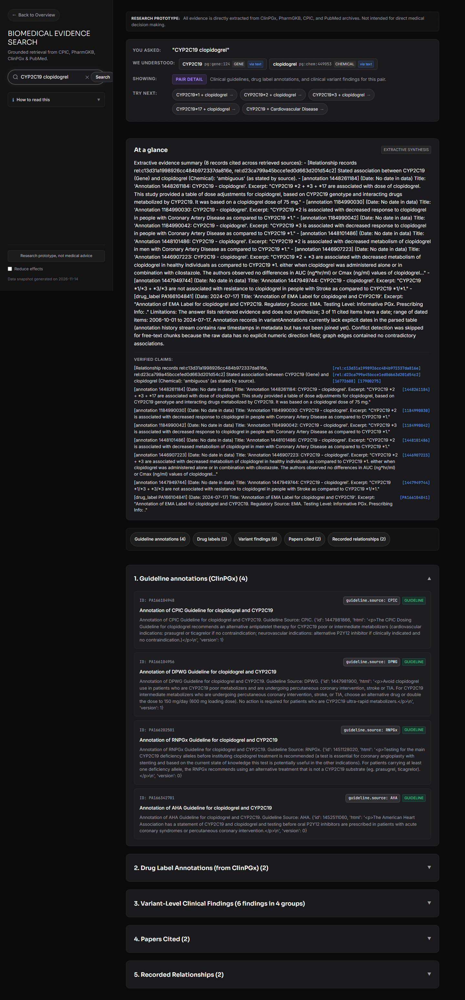

---

### 3. Variant Detail Mode
*Variant-specific findings (e.g., `CYP2C19*2 + clopidogrel` or `HLA-B*57:01 + abacavir`), reporting allele-level direction of effect, clinical significance, and population frequencies.*

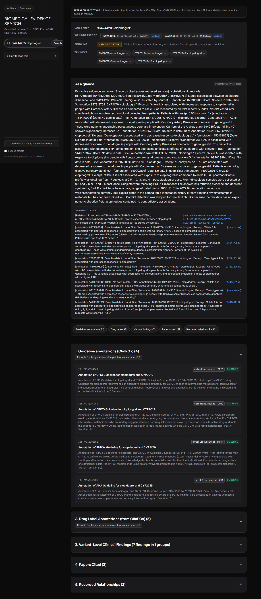

---

### 4. Medicine Overview Mode
*Curated gene interactions, chunk counts across sources, and linked papers for a single active ingredient (e.g., `codeine`, `warfarin`).*

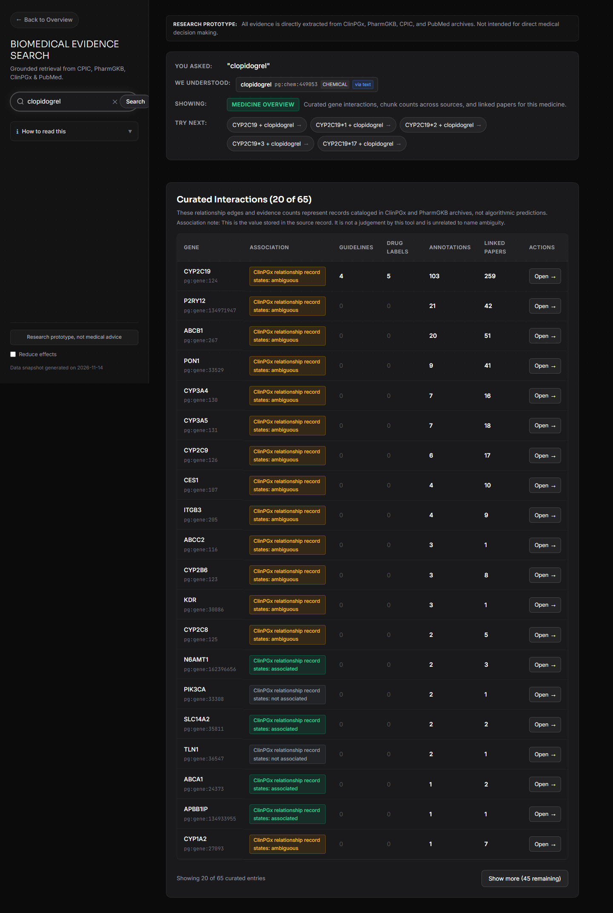

---

### 5. Indian Brand Name Lookup (NRCeS CDCI)
*Resolves Indian commercial brand medicines (e.g., `Dolo 650`, `Flexon`) to active chemical ingredients, combination statuses, and ClinPGx evidence entries without making clinical safety assertions.*

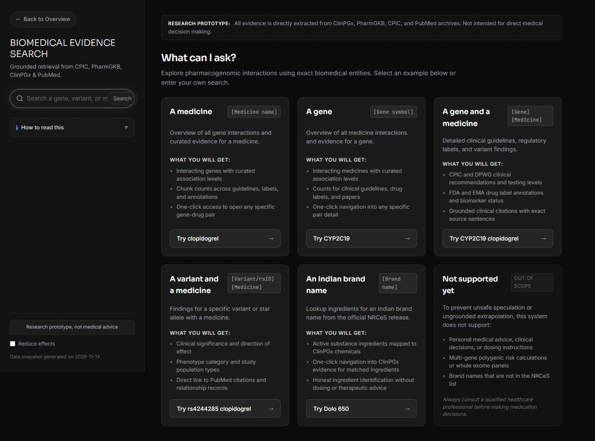

---

### 6. Ambiguity Resolution & Candidate Picker
*Detects ambiguous query terms (e.g., star allele collisions or multi-entity tokens) and prompts the user to select the precise target before retrieving evidence.*

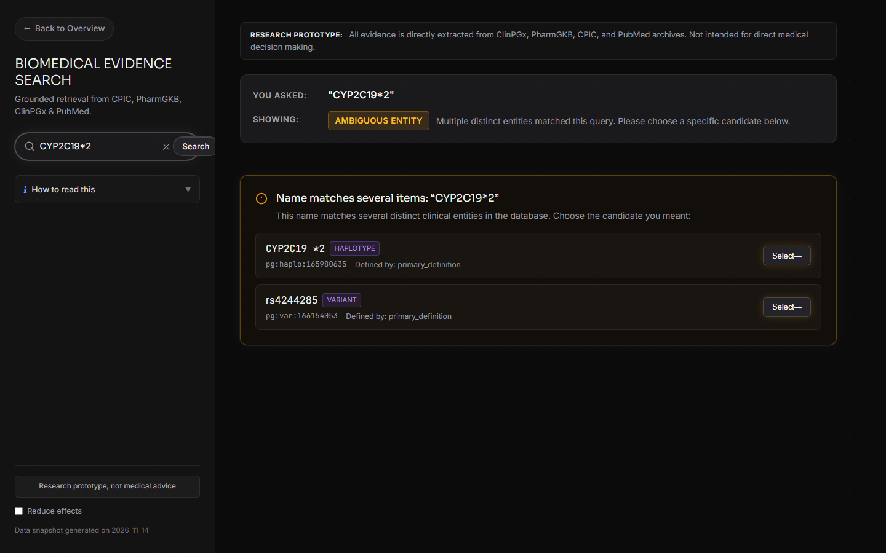

---

### 7. Clinical Guardrail Refusal Notice
*Intercepts dosage queries, direct medical advice, emergency symptoms, and adversarial injection attempts, returning a clinical safety refusal and emergency care instructions.*

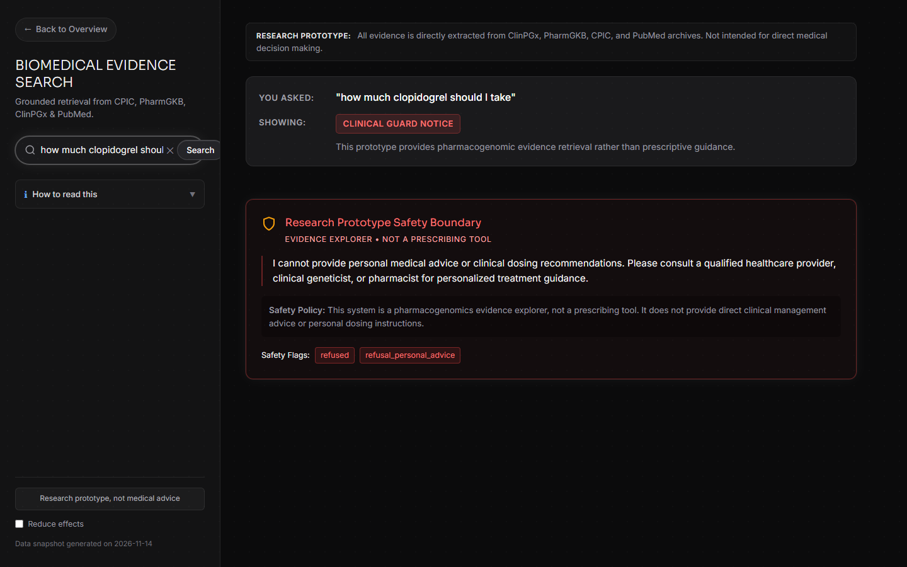

---

### 8. Unrecognized Queries & Supported Templates
*When an unsupported term or out-of-scope query is entered, displays a calm notice with copyable query templates.*

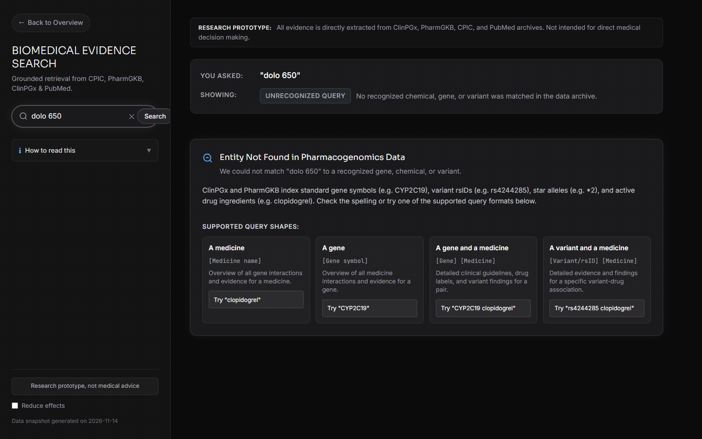

---

## Key Capabilities: What PharmaGraph Can Do

- **100% Extractive, Hallucination-Free Synthesis**: Synthesizes verified claims directly from retrieved guidelines, drug labels, and literature excerpts. Claims cite verifiable primary source IDs (e.g., `cpic:123`, `dl:456`, `pmid:789`).
- **Citation Verification Guard**: A strict citation verifier verifies every claim against the active evidence bundle. Any claim containing invented, misplaced, or ungrounded citations is removed before reaching the user.
- **Biomedical Entity Resolution**: Normalized resolution over genes, chemicals, star alleles (`CYP2C19*2`), rsIDs (`rs4244285`), haplotypes (`HLA-B*57:01`), and commercial brand names.
- **Phenotype & Non-Evidence Isolation**: When clinical phenotypes (e.g., `Pain`, `Cough`, `Hypersensitivity`) are entered alongside gene-drug pairs, PharmaGraph recognizes them in `also_recognized` chips without allowing chunk mismatch to zero out claims.
- **Hybrid Retrieval Core**: Fuses BM25 keyword search (biomedical tokenizer preserving `*`, `-`, and identifiers), dense semantic vector search (local Qdrant with `BAAI/bge-small-en-v1.5`), and structured knowledge graph traversal via Reciprocal Rank Fusion (RRF, $k=60$).
- **Curated Slot & Paper Reserves**: Ensures high-priority curated guidelines and drug labels always take precedent in top evidence slots, reserving dedicated slots for peer-reviewed papers linked directly to the query pair via curated relationship edges.
- **Indian Brand Integration**: Links over 200,000 NRCeS Common Drug Codes for India records to generic chemical entities and ClinPGx identifiers with sub-50ms fuzzy prefix search.
- **Fully Offline Execution**: Operates completely self-contained with no cloud dependencies, external network calls, or paid API keys.

---

## Safety Guardrails: What PharmaGraph Does NOT Do

- **NO Medical Advice or Dosing Instructions**: Diagnostic, prescriptive, dosing calculation, or treatment planning queries (e.g., *"How many mg should I take?"*) are refused by the `InputGuard`.
- **NO Extrapolated Claims or Inferred Links**: The system never guesses relationships between entities that do not have documented, co-grounded evidence in the underlying corpus.
- **NO Closed-Source Cloud Lock-in**: Zero telemetry, zero external tracking, and zero reliance on proprietary hosted model APIs.
- **NO Ungrounded Phenotype Narrowing**: Phenotypes and indications are not used as exclusionary filters when searching the pharmacogenomic corpus, preventing false negative evidence drops.
- **NO Medical Brand Safety Guarantees**: NRCeS brand lookup only maps commercial names to ingredients; it explicitly does not verify therapeutic equivalency, product quality, or off-label safety.

---

## System Architecture & Data Flow

### 1. High-Level System Architecture

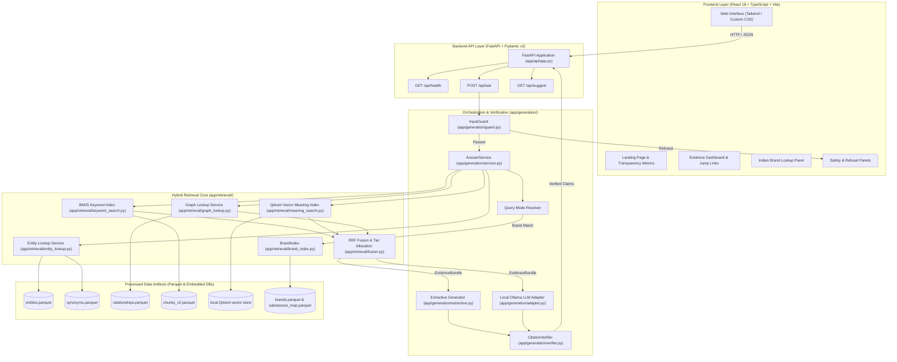

---

### 2. Hybrid Retrieval Pipeline Flow

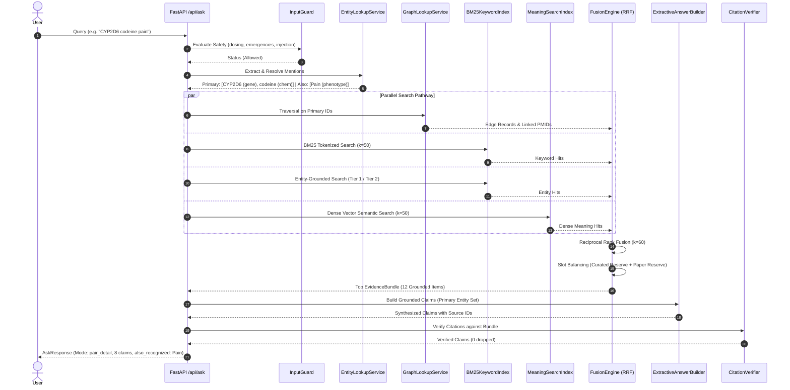

---

### 3. Query Mode & Intent Routing Logic

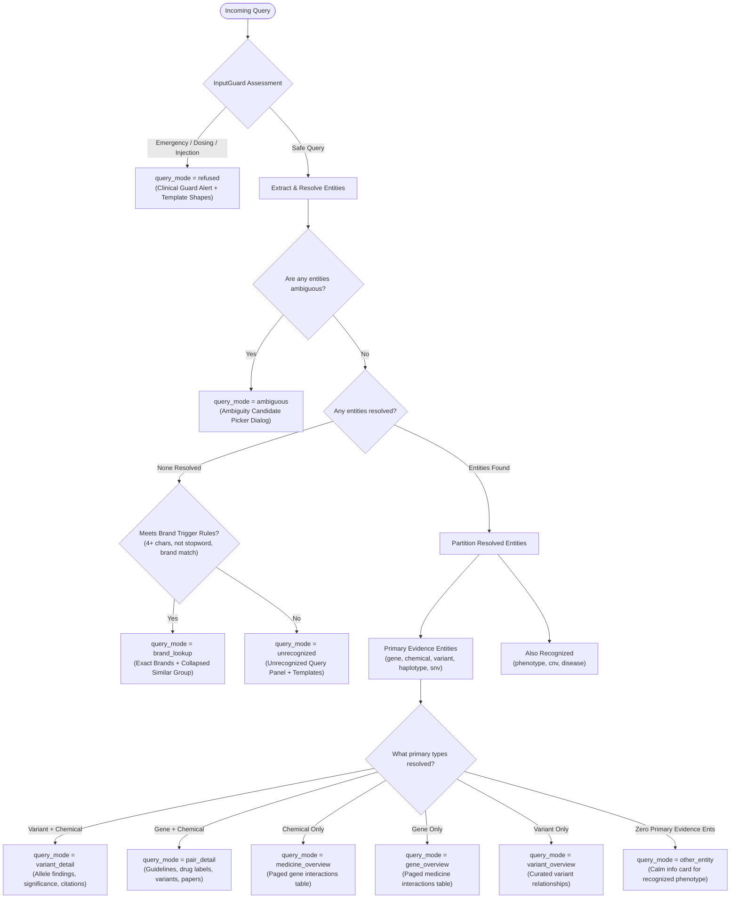

---

### 4. Extractive Claim Synthesis & Citation Verifier

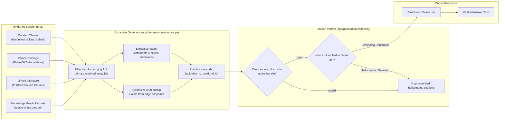

---

## Answer Modes

PharmaGraph supports three swappable answer generation backends:

| Mode | Compute Requirements | Determinism | Offline Capable | Hallucination Risk | Description |
| :--- | :--- | :--- | :--- | :--- | :--- |
| **`extractive`** *(Default)* | CPU only (<10 MB RAM) | 100% Deterministic | Yes (100% Offline) | **0%** (Strict verbatim extraction) | Extracts and groups facts directly from retrieved tables, guidelines, and annotations. Requires no GPU, model downloads, or API keys. |
| **`ollama`** *(Optional)* | Local GPU / CPU (Ollama) | High (temperature = 0.0) | Yes (Localhost only) | Very Low (Citation verified) | Connects to a locally running Ollama instance (`http://localhost:11434`, e.g., `llama3`). Includes JSON schema auto-repair and automatic fallback to extractive mode if unparseable. |
| **`mock`** *(Testing)* | Minimal | 100% Deterministic | Yes (100% Offline) | **0%** | Lightweight deterministic mock adapter used for continuous integration and unit testing. |

---

## Project File Structure

```text
PharmaRAG/
├── app/                               # Core Python backend source
│   ├── api/                           # FastAPI REST endpoints
│   │   ├── app.py                     # App factory, CORS middleware, router registration
│   │   └── routes.py                  # Endpoints: /api/ask, /api/suggest, /api/health
│   ├── generation/                    # Answer generation and safety modules
│   │   ├── adapter.py                 # Generation backends (Extractive, Ollama, Mock)
│   │   ├── checks.py                  # Evidence sufficiency and conflict detection
│   │   ├── config.py                  # Pydantic configuration settings
│   │   ├── contracts.py               # API data schemas (AskResponse, EvidenceBundle, Claims)
│   │   ├── extractive.py              # Extractive claim synthesis engine
│   │   ├── guard.py                   # Input safety guardrails (dosing, emergencies)
│   │   ├── service.py                 # Core answer orchestration service
│   │   └── verifier.py                # Post-generation citation and hallucination verifier
│   ├── normalization/                 # Ingestion parsing and entity normalization
│   │   ├── clinpgx_parser.py          # PharmGKB / ClinPGx XML & TSV processors
│   │   ├── cpic_parser.py             # CPIC clinical guidelines ingestion
│   │   ├── normalize.py               # String canonicalization & search keys
│   │   └── pubmed_parser.py           # XML literature parser
│   └── retrieval/                     # Hybrid search and entity resolution
│       ├── brand_index.py             # NRCeS Indian brand prefix index & persistent cache
│       ├── entity_lookup.py           # Case-sensitive & stopword-aware entity resolution
│       ├── fusion.py                  # Reciprocal Rank Fusion (RRF) & candidate ranking
│       ├── graph_lookup.py            # DuckDB-powered edge queries on relationships.parquet
│       ├── keyword_search.py          # BM25 index over biomedical chunks
│       ├── meaning_search.py          # Dense vector search using local Qdrant
│       ├── pipeline.py                # End-to-end hybrid retrieval coordinator
│       ├── suggest.py                 # Sub-50ms search dropdown autocomplete
│       └── tokenizer.py               # Specialized biomedical regex tokenizer
├── data/                              # Data archive directory
│   ├── processed/                     # Normalized Parquet tables & vector indexes
│   │   ├── chunks_v2.parquet          # Curated & literature chunks with entity_ids
│   │   ├── entities.parquet           # Canonical genes, chemicals, variants, phenotypes
│   │   ├── synonyms.parquet           # Normalized aliases & lookup mappings
│   │   ├── relationships.parquet      # Curated knowledge graph edges
│   │   ├── qdrant_db_full/            # Embedded local Qdrant vector database
│   │   └── nrces/                     # NRCeS Indian brand index & cache
│   └── raw/                           # Immutably versioned upstream raw source archives
├── docs/                              # Project documentation & assets
│   ├── licenses.md                    # Legal provenance and upstream license terms
│   └── screenshots/                   # UI reference screenshots for dashboard and landing
├── frontend/                          # React + TypeScript + Vite web client
│   ├── src/
│   │   ├── components/app/            # App dashboard panels (ResultsHeader, EvidenceCard, etc.)
│   │   ├── components/landing/        # Public landing page sections & transparency panels
│   │   ├── test/                      # Vitest component test suites
│   │   ├── App.tsx                    # Main query controller and edge-state routing
│   │   ├── index.css                  # Design system CSS styles
│   │   └── types.ts                   # Frontend TypeScript interfaces
│   ├── package.json                   # NPM dependencies and scripts
│   └── vite.config.ts                 # Vite bundler configuration
├── scripts/                           # Maintenance, benchmark, and CLI utilities
│   ├── demo_ask.py                    # Terminal CLI for /api/ask queries
│   └── generate_site_stats.py         # Static manifest generator for landing page metrics
├── tests/                             # Comprehensive backend Pytest test suite
│   ├── test_api.py                    # API contract, guardrails, and citation verifier tests
│   ├── test_d11_phenotype.py          # Tests for phenotype isolation & non-zero claims
│   ├── test_retrieval.py              # Unit tests for BM25, Qdrant, and RRF fusion
│   └── test_nrces_ingestion.py        # Brand lookup exact and similar matching tests
└── pyproject.toml                     # Python dependencies & build configurations
```

---

## Installation & Setup

### Prerequisites
- **Python**: 3.12 or newer
- **Node.js**: v18.x or newer (with `npm`)
- **Git**
- **Operating System**: Windows (PowerShell), macOS, or Linux

### 1. Clone the Repository
```bash
git clone https://github.com/your-org/PharmaRAG.git
cd PharmaRAG
```

### 2. Python Virtual Environment Setup
```powershell
# Windows PowerShell
python -m venv .venv
.\.venv\Scripts\Activate.ps1
python -m pip install --upgrade pip
pip install -e .
```

```bash
# macOS / Linux
python3 -m venv .venv
source .venv/bin/activate
pip install --upgrade pip
pip install -e .
```

### 3. Frontend Installation
```powershell
cd frontend
npm install
cd ..
```

---

## Running Backend & Frontend

Open two terminal windows to run both services locally:

### Terminal 1 — Start FastAPI Backend Server
```powershell
# Windows PowerShell
.\.venv\Scripts\Activate.ps1
$env:HF_HUB_OFFLINE="1"
$env:TRANSFORMERS_OFFLINE="1"
.\.venv\Scripts\python.exe -m uvicorn app.api.app:app --host 127.0.0.1 --port 8000
```
*Backend API starts at [`http://127.0.0.1:8000`](http://127.0.0.1:8000). Verify health via [`http://127.0.0.1:8000/api/health`](http://127.0.0.1:8000/api/health).*

### Terminal 2 — Start Vite React Frontend
```powershell
# Windows PowerShell
cd frontend
npm run dev -- --host 127.0.0.1 --port 5173
```
*Frontend will be live at [`http://localhost:5173`](http://localhost:5173) or [`http://127.0.0.1:5173`](http://127.0.0.1:5173).*

---

## Running Tests & Quality Checks

PharmaGraph enforces 100% test pass rates and strict zero-warning linting standards:

### 1. Backend Test Suite (Pytest)
```powershell
$env:HF_HUB_OFFLINE="1"
$env:TRANSFORMERS_OFFLINE="1"
.\.venv\Scripts\pytest.exe -q
```
*Executes all 166 backend tests covering pipeline retrieval, brand lookup, safety guardrails, and citation verification.*

### 2. Python Code Quality (Ruff)
```powershell
.\.venv\Scripts\ruff.exe check .
```

### 3. Frontend Tests (Vitest)
```powershell
cd frontend
npm run test
```
*Executes all 70 React component unit tests (including accessibility, chip rendering, and edge states).*

### 4. Frontend Lint & Typecheck
```powershell
cd frontend
npm run lint
npm run typecheck
npm run build
```

---

## Data Sources & Legal Provenance

Every data point rendered by PharmaGraph is tracked to an immutable raw file download with recorded SHA256 checksums:

| Source | Organization | Description | Upstream License |
| :--- | :--- | :--- | :--- |
| **ClinPGx / PharmGKB** | Stanford University / NIH | Curated variant-drug annotations and clinical evidence pairs. | [CC BY-SA 4.0](https://creativecommons.org/licenses/by-sa/4.0/) |
| **CPIC** | Clinical Pharmacogenetics Implementation Consortium | Peer-reviewed clinical implementation guidelines and dosing algorithms. | [CC BY-SA 4.0](https://creativecommons.org/licenses/by-sa/4.0/) |
| **NRCeS CDCI** | National Resource Centre for EHR Standards (Ministry of Health, India) | Common Drug Codes for India commercial brand names and substance maps. | Open Government Data (OGD) India |
| **PubMed / MEDLINE** | National Library of Medicine (NIH) | Biomedical scientific literature abstracts linked to curated PGx associations. | Public Domain (NLM / US Government) |
| **Drug Label Annotations** | US FDA / PharmGKB | Regulatory PGx biomarker information extracted from approved package inserts. | Public Domain |

For complete licensing terms, notices, and attribution statements, see [docs/licenses.md](file:///d:/PharmaRAG/docs/licenses.md).

---

## Disclaimer

> [!WARNING]
> **Research Prototype Notice**: PharmaGraph is designed strictly for biomedical research and clinical information retrieval. It is **not** a certified medical device, does not provide prescriptive clinical guidance or individualized medical advice, and must not replace professional clinical diagnosis or consultation with a qualified healthcare provider.
